# DSR

DSR (Dual-level Self-improving Robotics) connects robot execution with persistent
capability development. It composes registered capabilities through typed contracts,
preserves task state across replanning, and evolves executable capabilities together
with the mechanisms that develop them.

This repository provides evaluation code, configuration templates, real-robot
deployment tools, and multi-view manipulation videos.

## Videos

Eight recordings are shown from the head camera and both wrist cameras. Select a
preview to open the corresponding video. All 24 original clips are in
[`media/videos`](media/videos). After cloning, open
[the video gallery](media/videos/index.html) in a browser for playback.

| Recording | Head camera | Left wrist | Right wrist |
| --- | --- | --- | --- |
| 01. Object-rich tabletop scene | [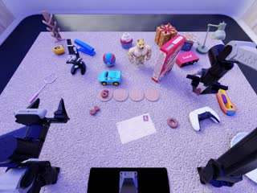](media/videos/episode_0000003_cam_head_success.mp4) | [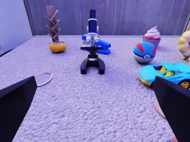](media/videos/episode_0000003_cam_left_wrist_success.mp4) | [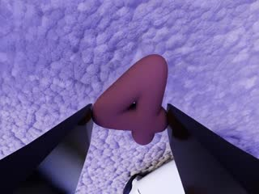](media/videos/episode_0000003_cam_right_wrist_success.mp4) |
| 02. Shirt folding | [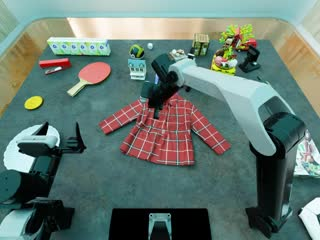](media/videos/episode_0000004_cam_head_success.mp4) | [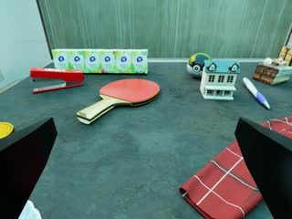](media/videos/episode_0000004_cam_left_wrist_success.mp4) | [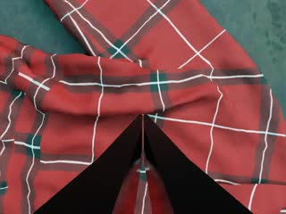](media/videos/episode_0000004_cam_right_wrist_success.mp4) |
| 03. Mug placement, recording A | [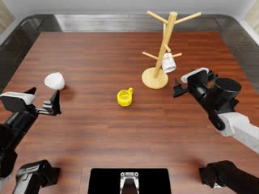](media/videos/episode_0000006_cam_head_success.mp4) | [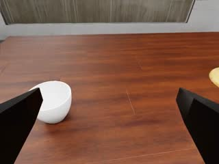](media/videos/episode_0000006_cam_left_wrist_success.mp4) | [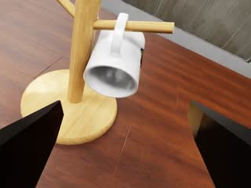](media/videos/episode_0000006_cam_right_wrist_success.mp4) |
| 04. Mug placement, recording B | [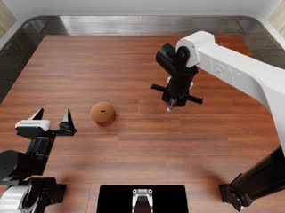](media/videos/episode_0000006_cam_head_success%20copy.mp4) | [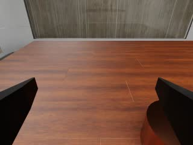](media/videos/episode_0000006_cam_left_wrist_success%20copy.mp4) | [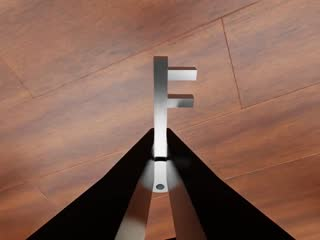](media/videos/episode_0000006_cam_right_wrist_success%20copy.mp4) |
| 05. Digit arrangement | [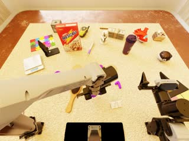](media/videos/episode_0000007_cam_head_success.mp4) | [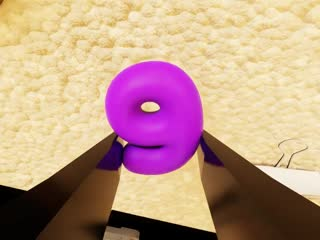](media/videos/episode_0000007_cam_left_wrist_success.mp4) | [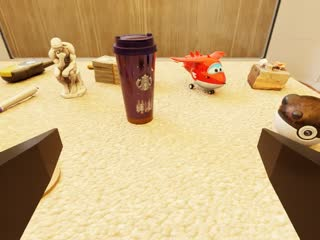](media/videos/episode_0000007_cam_right_wrist_success.mp4) |
| 06. Desktop organization | [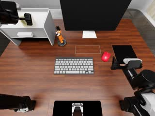](media/videos/episode_0000008_cam_head_success.mp4) | [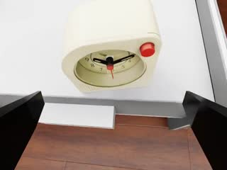](media/videos/episode_0000008_cam_left_wrist_success.mp4) | [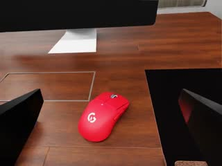](media/videos/episode_0000008_cam_right_wrist_success.mp4) |
| 07. Threaded-part assembly | [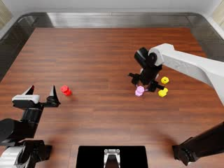](media/videos/episode_0000010_cam_head_success.mp4) | [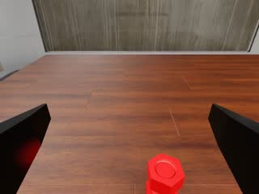](media/videos/episode_0000010_cam_left_wrist_success.mp4) | [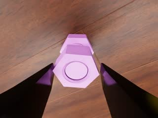](media/videos/episode_0000010_cam_right_wrist_success.mp4) |
| 08. Holder packing | [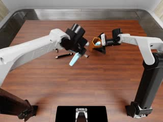](media/videos/episode_0000015_cam_head_success.mp4) | [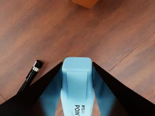](media/videos/episode_0000015_cam_left_wrist_success.mp4) | [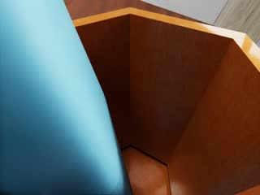](media/videos/episode_0000015_cam_right_wrist_success.mp4) |

## Install

Use Python 3.11 and an internet-enabled machine:

```bash
git clone https://github.com/raozf/DSR-RSI.git
cd DSR-RSI
DSR_PYTHON=/path/to/python3.11 scripts/install.sh
.venv/bin/dsr doctor
```

Copy `configs/local.example.json` to `configs/local.json` and set the four worker
interpreters plus external checkpoint, RoboDojo asset, code-skill asset, and Codex
configuration paths. Apply it explicitly with `dsr --config configs/local.json`.

## RoboDojo evaluation

Install IsaacSim, IsaacLab, and cuRobo and obtain RoboDojo assets and policy
checkpoints outside this repository. The included `vendor/RoboDojo` directory is
runtime source; simulator dependencies remain external. For a bounded smoke run:

```bash
.venv/bin/dsr --config configs/local.json evaluate \
  --policy integrated --recovery single-restart \
  --policy-gpus 0 --env-gpus 1 \
  --seeds 0 --tasks cover_blocks --episodes 1 \
  --run-id smoke --output-root /external/dsr-results --state-root /external/dsr-state
```

For the full protocol use disjoint policy and simulator GPUs with `--seeds 0,1,2`.
For example, on eight available GPUs:

```bash
.venv/bin/dsr --config configs/local.json evaluate \
  --policy integrated --recovery single-restart --full-protocol \
  --policy-gpus 0,2,4,6 --env-gpus 1,3,5,7 --seeds 0,1,2 \
  --run-timeout 86400 --run-id full-eval \
  --output-root /external/dsr-results --state-root /external/dsr-state
```

The launcher writes `task_accuracy.json` and episode records below the external
output root; state and resume locks live below the external state root.

The OpenDM checkpoint helper is
`vendor/XPolicyLab/policy/OpenDM/download_checkpoint.sh`. RoboDojo assets can be
fetched with `vendor/RoboDojo/scripts/init_assets.sh`, and the code-skill bundle
with `tools/fetch_physicalrsi_assets.py`.

## XTrainer deployment

```bash
cd xtrainer_real
./scripts/install_ws.sh
./ws_dry_run.sh
./run_ws_server.sh --host 127.0.0.1 --port 18000
./run_ws_client.sh --check-only
```

Fill measured files under `xtrainer_real/local/`, run `--preflight`, and add
`--execute` only after the existing robot node, calibration, scene, and emergency
stop have been checked. The adapter supports the `align_blocks` and `cover_blocks`
precompiled Code Policy plans and does not start the robot node.

## Layout

`src/dsr` contains the DSR execution and development runtime, `tools` contains
evaluation and asset helpers, `configs` contains schemas and templates, and
`xtrainer_real` contains the WebSocket client/server and hardware adapter. Vendor
license files remain beside their source trees.
